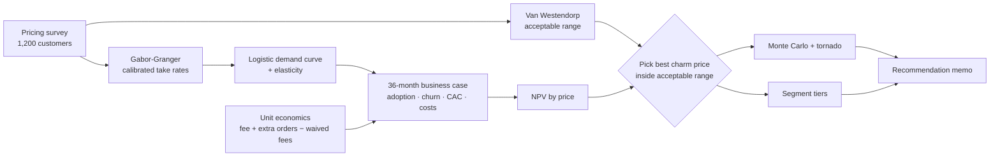

# PricePilot: Pricing & Business Case Simulator

**Turns a customer pricing survey into a recommended price, a 36-month business case and a risk view, so "what should we charge?" gets an evidence-based answer instead of a guess.**

Pricing is one of the highest-leverage decisions a PM makes, and one of the least rigorous. Teams copy a competitor, pick a round number, or ask "would you pay ₹99?", when people's stated intent overstates what they will actually do. PricePilot combines two standard willingness-to-pay methods with unit economics and Monte Carlo risk analysis. It then writes a recommendation a leadership team can challenge line by line.

> Built as an end-to-end product case study: membership PRD, survey design, pricing analytics, financial model, risk analysis, go-to-market plan and dashboard.

---

## The story

In the companion projects, [SignalSift](https://github.com/anamikatripathi2023-ui/signalsift-ai-feedback-engine) found that **delivery and handling fees** were a growing complaint for FreshKart (a fictional 10-minute grocery app), and [ShipOrSkip](https://github.com/anamikatripathi2023-ui/shiporskip-experiment-decision-engine) fixed the #1 issue, payment failures. The next growth bet:

> **FreshKart Plus:** a monthly membership with free delivery and no handling fee on orders above ₹99, plus member-only deals.

The PM must answer: **What price? One tier or several? Does it make money, and how sure are we?**

## What PricePilot does

| Step | Method | Output |
|---|---|---|
| **1. Willingness to pay** | Van Westendorp Price Sensitivity Meter, overall and per segment | Acceptable price range and optimal price point |
| **2. Demand** | Gabor-Granger purchase intent, **calibrated for the say-do gap**, with a fitted logistic demand curve | Take rate at any price, price elasticity |
| **3. Unit economics** | Subscription + margin on extra orders − fees waived | Contribution per member, LTV:CAC, CAC payback |
| **4. Business case** | 36-month model: S-curve adoption, churn, CAC, build and fixed costs | NPV, payback month, P&L |
| **5. Price choice** | NPV across prices, limited to the acceptable range and snapped to a charm price (₹99, not ₹104) | Recommended price and tiers |
| **6. Risk** | 5,000-run Monte Carlo + tornado sensitivity on the 5 least certain inputs | P(NPV > 0), P10/P50/P90, biggest risk drivers |

## Results on the sample survey (1,200 synthetic respondents)

| Question | Answer |
|---|---|
| Acceptable price range | **₹50 – ₹144** / month (optimal ₹75, indifference ₹94) |
| Recommended price | **₹99 / month**: highest-NPV charm price inside the acceptable range |
| 3-year NPV | **₹16.7 crore**, payback in **month 11**, ~182,000 members |
| Unit economics | **₹59** contribution per member per month; **LTV:CAC 6.6x**; CAC paid back in 2.5 months |
| Risk | NPV > 0 in **96%** of 5,000 simulations (P10 ₹2.9 cr, P50 ₹12.3 cr, P90 ₹22.5 cr) |
| Biggest risk | **Fees waived per order**: from ₹12 to ₹26, NPV goes from +₹30.9 cr to **−₹2.3 cr** |
| Segment insight | Students' optimal price is ₹50 vs ₹110 for families → **student tier at ₹49** (still profitable at ₹24/member/month) |

**Three insights a spreadsheet would hide:**
1. **Cheaper isn't safer.** Below about ₹40/month, every member *loses* money, because waived fees outweigh the fee. More members at a low price means a larger loss.
2. **The model's optimum (₹104) isn't the launch price.** The NPV curve is flat near the top, so ₹99 costs almost nothing and reads as much cheaper.
3. **The biggest risk isn't demand, it's cost.** Fee waivers move NPV more than take rate, churn or CAC do. Hence the first mitigation: keep the ₹99 minimum basket for free delivery.

Read the generated [pricing recommendation](outputs/pricing_recommendation.md) and [36-month P&L](outputs/pnl_36_months.csv).

## How it fits together



## Product documents

| Doc | What's inside |
|---|---|
| [PRD: FreshKart Plus](docs/PRD_PLUS.md) | Problem, evidence, value proposition, requirements, success metrics |
| [Research design](docs/RESEARCH_DESIGN.md) | Survey questionnaire, sampling, bias controls, say-do calibration |
| [Go-to-market plan](docs/GO_TO_MARKET.md) | Positioning, launch phases, fake-door test, pricing experiment, kill criteria |
| [Decision log](docs/DECISIONS.md) | Why these methods, charm pricing, city-level price tests, NPV over revenue |
| [Demo script](docs/DEMO_SCRIPT.md) | 5-minute walkthrough |

## Run it

Requires Python 3.10+.

```bash
git clone https://github.com/anamikatripathi2023-ui/pricepilot-pricing-business-case.git
cd pricepilot-pricing-business-case
python -m venv .venv
# Windows: .venv\Scripts\activate    macOS/Linux: source .venv/bin/activate
pip install -r requirements.txt

streamlit run app.py                         # interactive dashboard (change any assumption)
python -m pricepilot.recommend               # writes outputs/pricing_recommendation.md
python -m pricepilot.recommend --price 149   # evaluate a specific price
python -m pytest                             # 18 tests
```

To regenerate the survey: `python -m pricepilot.survey`. To use your own survey, upload a CSV with the same columns
(`vw_too_cheap`, `vw_cheap`, `vw_expensive`, `vw_too_expensive`, `gg_49` … `gg_199`, and optionally `segment`).

## Project structure

```
pricepilot/
├── app.py                  # Streamlit dashboard (WTP → demand → business case → risk → memo)
├── pricepilot/
│   ├── survey.py           # synthetic survey generator (hidden WTP per respondent)
│   ├── pricing.py          # Van Westendorp, Gabor-Granger calibration, demand curve, elasticity
│   ├── business_case.py    # unit economics, 36-month P&L, NPV, Monte Carlo, tornado
│   └── recommend.py        # price choice, segment tiers, recommendation memo + CLI
├── data/pricing_survey.csv
├── outputs/                # recommendation memo + P&L
├── docs/                   # PRD, research design, GTM, decision log, demo script
└── tests/                  # maths checked by hand + app smoke tests
```

## Limitations and next steps

- **Stated, not revealed, preference.** Calibration helps, but the fake-door test in the [GTM plan](docs/GO_TO_MARKET.md) is the real check.
- **Self-selection.** Heavy users join first and cost more in waived fees. The model uses an average joiner; a cohort model would be more accurate.
- **No competitor response.** If a rival cuts its membership price, demand shifts. That could be added as a scenario.
- **Synthetic data.** FreshKart and the survey are fictional; the methods are standard and transfer directly.

## Part of a 3-project product series

One fictional product (FreshKart) taken through the full product lifecycle:

| Stage | Project |
|---|---|
| Discover: what should we build? | [SignalSift: AI Voice-of-Customer Engine](https://github.com/anamikatripathi2023-ui/signalsift-ai-feedback-engine) |
| Launch: does it work, should we ship? | [ShipOrSkip: Experiment Decision Engine](https://github.com/anamikatripathi2023-ui/shiporskip-experiment-decision-engine) |
| Monetise: what should we charge? | [PricePilot: Pricing & Business Case Simulator](https://github.com/anamikatripathi2023-ui/pricepilot-pricing-business-case) |

## License

MIT. See [LICENSE](LICENSE).
